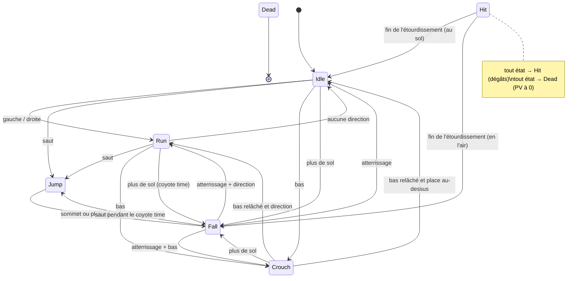

# Kill_ops_1

**Créateur :** Arthur Durand Nuekumo Simo
**Cours :** 420-0SW – Programmation jeux et multimédias
**Moteur :** Godot 4.7.2

## Description

Des insectes géants envahissent la Terre, et tu fais partie de l’unité des forces spéciales de l’armée canadienne envoyée pour les arrêter.. Kill Ops 1 est un jeu de tir à défilement horizontal (*run and gun*) inspiré de *Metal Slug* : tu avances dans chaque mission, tu élimines des vagues d'insectes avec tes armes et tes grenades, tu libères les humains prisonniers de cocons, puis tu affrontes la Reine, le boss de fin.

## Objectifs du jeu

- Traverser la mission jusqu'à la fin sans perdre toutes ses vies. Une seule attaque suffit à faire perdre une vie.
- Éliminer les insectes pour faire le meilleur score possible.
- Libérer les otages pour gagner des armes, des grenades et des points bonus.
- Vaincre le boss de fin de mission.

## Contrôles

| Action | Clavier | Manette / borne |
|---|---|---|
| Se déplacer | ← → / A D | Joystick |
| Viser en haut | ↑ / W| Joystick haut |
| S'accroupir / viser en bas (en saut) | ↓ / S | Joystick bas |
| Sauter | F | *à définir* |
| Tirer / couteau (au corps à corps) | T | *à définir* |
| Lancer une grenade | G | *à définir* |
| Pause | P | *à définir* |
| Couper le son | Ctrl + M | — |
| Informations de débogage | F12 | — |

## Ennemis prévus

| Insecte | Comportement |
|---|---|
| Fourmi soldat | Infanterie de base, attaque en groupe |
| Termite | Surgit du sol par surprise |
| Guêpe | Vole et attaque en piqué |
| Araignée | Descend du plafond, sa toile ralentit le joueur |
| Scarabée blindé | Résiste aux balles, vulnérable aux explosifs |
| Criquets | Essaim rapide et fragile |
| Mante religieuse | Mini-boss, combat au corps à corps |
| La Reine | Boss final, plusieurs phases, pond des larves |

## Machine à états du soldat (patron État)

Chaque état est un nœud enfant de `Player/StateMachine` (`scripts/player/states/`). Un état décide lui-même de ses transitions en émettant `Transitioned`. Seuls **Hit** et **Dead** sont déclenchés de l'extérieur, par `Player.take_damage()` via `StateMachine.transition_to()`.

Règles garanties par la structure : pas de saut en l'air (le saut n'existe que depuis Idle, Run, et Fall pendant le coyote time), pas de saut accroupi (Crouch ne mène jamais à Jump), on ne se relève pas sous un plafond bas, et aucun dégât pendant l'invincibilité qui suit un coup.

### Scène de test (`scenes/tests/test_player.tscn`)

| Touche | Effet |
|---|---|
| H | 10 points de dégâts (état Hit) |
| K | Mort immédiate (état Dead) |
| R | Recharger la scène |
